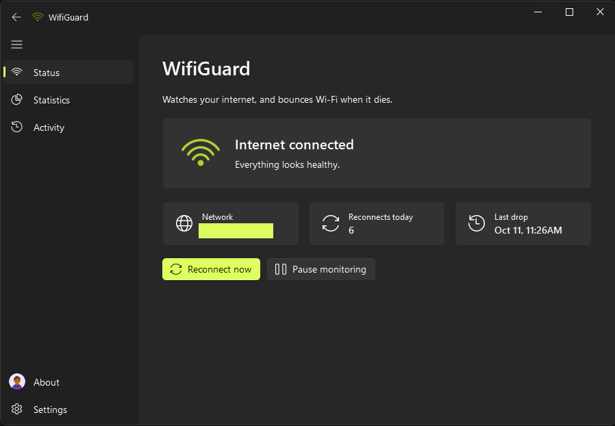
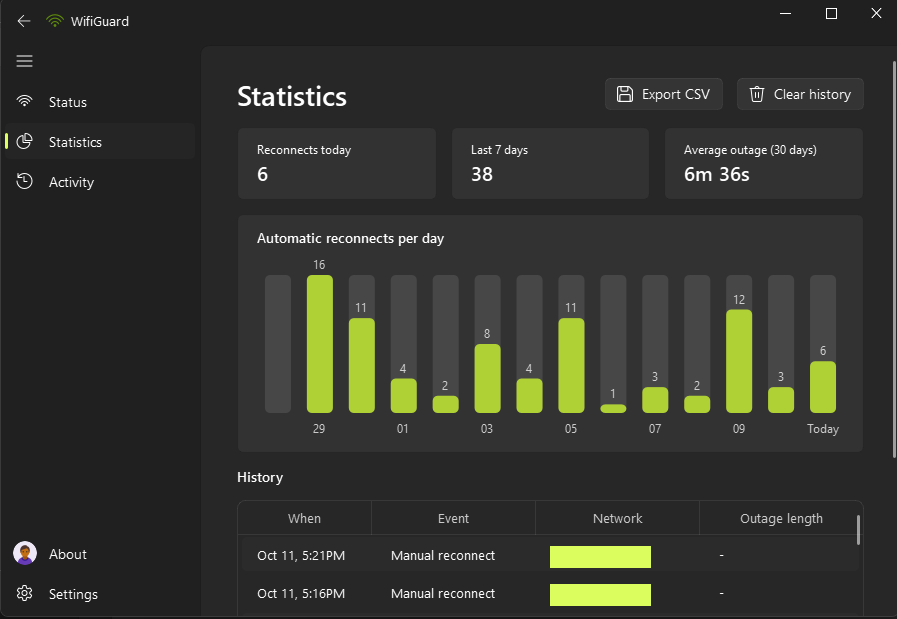
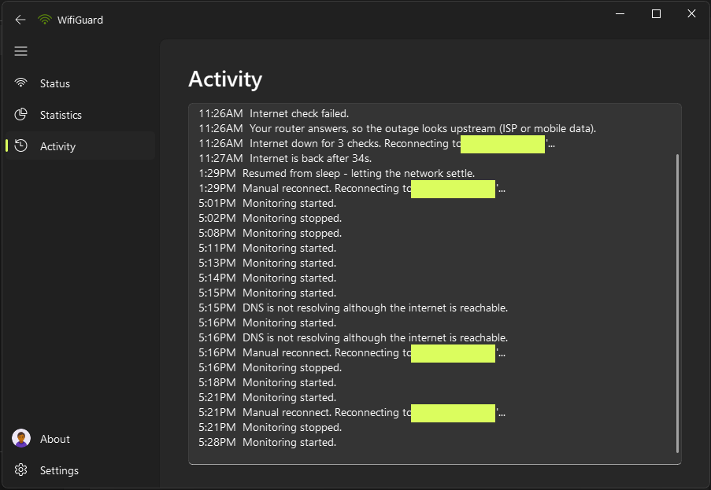
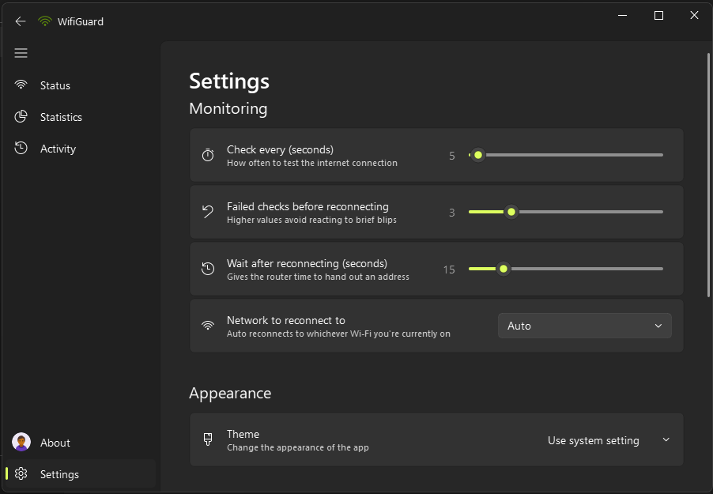
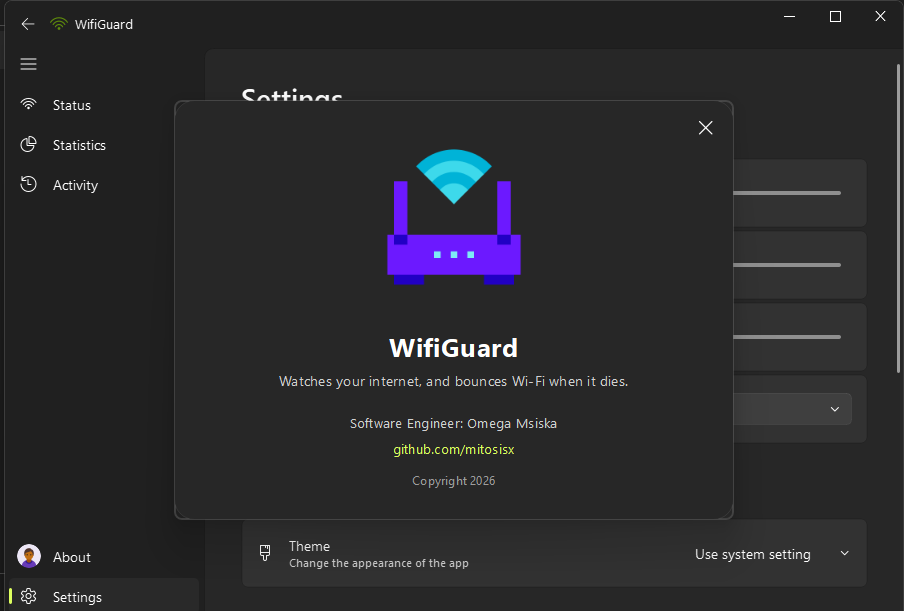

# WifiGuard

WifiGuard watches your internet connection and reconnects your Wi-Fi when it dies, so you
don't have to keep doing it by hand every time the connection drops.

### [⬇ Download WifiGuard for Windows](https://github.com/mitosisX/WifiGuard/releases/latest/download/WifiGuard.zip)

The link always gets the newest version. Older versions are on the
[Releases page](https://github.com/mitosisX/WifiGuard/releases).



## Install

1. Download **WifiGuard.zip** with the link above.
2. Right-click the zip and choose **Extract All...**, and put the folder anywhere
   (for example `Documents\WifiGuard`).
3. Open the folder and run **WifiGuard.exe**.

You don't need Python or anything else; everything is in the folder. Keep `WifiGuard.exe`
next to its `_internal` folder, because the exe won't run on its own.

**"Windows protected your PC"?** The app isn't code-signed yet, so Windows SmartScreen may
warn you the first time. Click **More info**, then **Run anyway**.

## What it does

- **Reconnects automatically.** It checks the connection every few seconds. After several
  failed checks in a row, it disconnects your Wi-Fi and connects it again.
- **Notices when DNS fails.** Sometimes the network is up but websites stop loading.
  WifiGuard catches that too and reconnects if it doesn't recover.
- **Reconnect now / Pause monitoring.** You can do either with one click from the Status page
  or the tray icon.
- **Statistics.** See reconnects today, the last 7 days and the average outage length, with a
  daily chart and a full history you can export to CSV.
- **Activity log.** Everything WifiGuard did today, kept across restarts.
- **Tray notifications.** You get one when it reconnects and one when the internet is back,
  showing how long the outage lasted.
- **Runs quietly in the tray.** It can start with Windows and keep watching after you close
  the window.
- **Light and dark theme**, or follow your Windows setting.

## Screenshots

| Statistics | Activity |
| --- | --- |
|  |  |
| **Settings** | **About** |
|  |  |

## Settings

| Setting | Default | What it changes |
| --- | --- | --- |
| Check every | 5 seconds | How often the connection is tested |
| Failed checks before reconnecting | 3 | Higher values ignore brief blips |
| Wait after reconnecting | 15 seconds | Gives the router time to hand out an address |
| Network to reconnect to | Auto | Auto uses whichever Wi-Fi you're on |
| Start with Windows | Off | Starts minimized to the tray when you sign in |
| Keep running in tray on close | On | Off makes closing the window quit WifiGuard |

Settings and history are stored in `%APPDATA%\WifiGuard`.

## Requirements

- Windows 10 or 11
- A Wi-Fi adapter

## Running from source

```
pip install -r requirements.txt
python main.py
```

To build the Windows app yourself:

```
pip install pyinstaller
python build.py
```

The app is written to `dist\WifiGuard\WifiGuard.exe`. Run `python build.py --help` for the
other options.

## Contributing

Bug reports, ideas and pull requests are welcome.

- **Found a bug or have an idea?** [Open an issue](https://github.com/mitosisX/WifiGuard/issues).
  For a bug, say what happened, what you expected, and your Windows version. The
  **Activity** page's log helps a lot.
- **Want to change the code?** For anything bigger than a small fix, open an issue first so
  we can agree on the approach. Then fork the repo, make your change on a branch, and open a
  pull request against `main`.
- **Before sending a pull request,** run the tests with `python -m pytest` and check that
  the app still starts with `python main.py`.

## Author

Made by **Omega Msiska**. Find me on GitHub at [@mitosisX](https://github.com/mitosisX).

## Credits

- Icons by [Icons8](https://icons8.com).
- Built with [PySide6](https://doc.qt.io/qtforpython-6/) and
  [PySide6-Fluent-Widgets](https://github.com/zhiyiYo/PyQt-Fluent-Widgets).

## License

Copyright (C) 2026 Omega Msiska

WifiGuard's source code is released under the [MIT License](LICENSE). You can use it, change
it, and port it to other platforms or languages under any license you like, as long as you
keep the copyright notice.

The Windows download also includes
[PySide6-Fluent-Widgets](https://github.com/zhiyiYo/PyQt-Fluent-Widgets), which is GPLv3, so
that download as a whole is distributed under the GPLv3. This only matters if your fork
still uses Fluent Widgets. A port built on a different UI library isn't affected. See
[licenses/THIRD-PARTY.txt](licenses/THIRD-PARTY.txt) for every bundled component.
